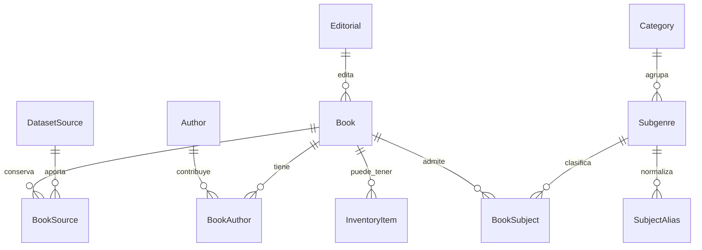

# Catálogo bibliográfico: selección de Kaggle y modelo basado en ECRMNL

Fecha de revisión: 2026-09-04. Estado: fuentes descargadas y perfiladas;
modelo propuesto, sin migración, importación a base de datos ni despliegue.

Actualización 2026-09-05: revisión externa parcial de trece fichas, con 82
candidatas y 2 en cuarentena. Cero admitidas. La evidencia y los pendientes
están en [la segunda pasada editorial](research/goodreads-editorial-review-round2-2026-09-05.md)
y en [el primer lote](research/goodreads-editorial-review-2026-09-05.md).
El detalle de normalización siguiente describe la etapa inicial; las decisiones
de `editorial-review.json` se aplican después, sin alterar el crudo.

## Implementación local — 2026-09-05

La etapa 1 está implementada; la recuperación **lexical local** de las candidatas
tiene una comprobación inicial. Las etapas de modelo relacional, embeddings,
ampliación e integración pública siguen pendientes.

### Artefactos y contrato

- `scripts/etl-goodreads.py` reutiliza la normalización y el verificador ISBN del
  perfil existente. Verifica hash del CSV original y correspondencia exacta de
  los campos del subconjunto antes de generar datos. No modifica los originales.
- Las decisiones editoriales admiten idioma, roles, síntesis breves propias y
  materias existentes. Descripción y materias exigen evidencia por campo;
  se conserva el crudo. Las materias añadidas editorialmente usan
  `basis: editorial-evidence`, estado `proposed`, y no simulan provenir de un
  alias automático. No se admite todavía ninguna ficha como `reviewed`.
- `imports/kaggle-goodreads/normalized.reference.json`: 84 fichas, `catalogKind:
  reference`, estado global `in-review` y estado individual `candidate` o
  `quarantined`; contrato local schemaVersion 1, separado
  del schemaVersion 2 de importación comercial. No contiene campos comerciales
  normalizados ni portadas publicables. El campo `source.raw` conserva la fuente.
- Identidad `goodreads-<id numérico>` independiente de título, idioma o ISBN.
  Una repetición del ID numérico falla aunque cambie el sufijo del `bookId`.
  No se fusionan ediciones por similitud ni se resuelven personas homónimas.
- `contributors` conserva orden, texto original, roles múltiples y fundamento.
  Sin rol explícito, sólo la primera posición propone autoría; los demás quedan
  como colaboradores sin rol resuelto. `more…` se registra como truncamiento,
  no como persona. La autoría provisional no equivale a verificación editorial.
- `data/taxonomy.controlled.json.sourceMappings` contiene once alias de origen
  versionados hacia términos existentes. Cada materia conserva etiqueta, versión,
  tipo y estado `proposed`. No cambia los siete chips ni los 21 subgéneros.
  Una etiqueta Poetry no prueba que un teatro sea poesía; Psychology no prueba
  carácter académico. Los cruces se señalan en la cola de revisión.
- ISBN inválido queda nulo en el campo normalizado y conservado en el crudo.
  Un ISBN con checksum correcto no demuestra correspondencia con la edición.
  Idioma desconocido es `und`; multilingüe es `mul`, sin asumir lenguas concretas.
- Las URLs por libro se derivan del ID y llevan `recordUrlVerified: false`;
  la evidencia contrastada es el CSV local. Fechas de edición y portadas quedan
  en el crudo, sin inventar fechas de verificación bibliográfica.

Resultado: 80 ISBN-13 válidos por checksum; cuatro descripciones ausentes; siete
fichas con roles pendientes y una con lista truncada. Hay 36 fichas con incidencias
específicas en `normalization-quality.json`; todas las 84 requieren revisión
editorial antes de admisión, incluidas las 48 sin incidencias detectadas.

### Recuperación evaluable

`src/lib/reference-search.js` reutiliza la normalización textual existente y
pondera campos: coincidencia exacta de ISBN/título/autor, luego tokens en título,
autor, colaborador, materia y descripción. Exige todos los términos significativos;
devuelve puntaje y campos coincidentes. Idioma, categoría y materia se filtran
antes del límite. Acepta el indicio literal `en español`/`en inglés`; el resto de
los filtros se pasa explícitamente. No hace corrección de errores, stemming,
traducción ni búsqueda semántica.

Las candidatas sólo se consultan con `includeCandidates: true`; la lectura por
defecto no las admite. Este módulo no está conectado a la web ni al importador.
`tests/fixtures/reference-queries.json` fija veinte consultas con IDs esperados,
incluidos Rulfo, título exacto, ISBN, poesía de Paz, idioma desconocido,
colaboradores y ausencia de resultados. Los casos validan el comportamiento
técnico sobre la instantánea, no son veinte juicios editoriales independientes
ni una medición de relevancia semántica. Las materias propuestas se usan sólo
para esta evaluación local y no se presentan como clasificación aprobada.

### Reproducción

Desde la raíz, con Python 3 estándar y Node ya instalado:

```powershell
python -B scripts/etl-goodreads.py
python -B scripts/etl-goodreads.py --check
python -B -m unittest discover -s tests -p test_goodreads.py
npm run reference:check
npm test
```

`--check` recalcula y compara los artefactos byte por byte sin escribir. El proceso
no usa red, credenciales, embeddings ni servicios. En este equipo `python` no
está en PATH; se ejecutó con este runtime existente:

```powershell
$catalogPython = 'C:\Users\aldog\.cache\codex-runtimes\codex-primary-runtime\dependencies\python\python.exe'
$env:PYTHONIOENCODING = 'utf-8'
& $catalogPython -B scripts/etl-goodreads.py --check
& $catalogPython -B -m unittest discover -s tests -p test_goodreads.py
```

Prerrequisitos locales: ZIP original, subconjunto y `editorial-review.json` bajo `imports/kaggle-goodreads`,
perfil auxiliar en `imports/kaggle-books-es/profile.py` y taxonomía controlada.
`imports/**` sigue excluido del hosting. Una modificación deliberada de fuente
o alias requiere regenerar y revisar los resultados antes de aceptar el gate.

## Decisión

Usar **GoodReads Best Books** como fuente candidata de enriquecimiento. Tiene
presencia comprobada de los temas solicitados y de varios autores mexicanos.
No constituye una colección completa de literatura mexicana ni una fuente
suficiente de psicología académica en español. La fuente se obtiene en
[Kaggle](https://www.kaggle.com/datasets/thedevastator/comprehensive-overview-of-52478-goodreads-best-b).

Se conserva el catálogo actual. La nueva fuente alimentará descubrimiento
bibliográfico; sólo datos de la librería podrán afirmar precio o existencias.
Esto requiere distinguir una referencia bibliográfica real de un fixture y de
una edición disponible en tienda.

## Comparación y evidencia

Los dos primeros resultados se midieron sobre sus CSV completos; los restantes
se compararon únicamente por sus fichas públicas.

| Fuente | Evidencia | Decisión |
|---|---|---|
| [GoodReads Best Books](https://www.kaggle.com/datasets/thedevastator/comprehensive-overview-of-52478-goodreads-best-b) | 52 478 filas, géneros múltiples, descripciones, ISBN e idioma; 687 filas declaradas Spanish | Elegida como candidata; requiere limpieza y enriquecimiento de ediciones en español |
| [Books with ISBN of different genres](https://www.kaggle.com/datasets/danielalbarracinm/books-with-isbn-of-different-genres) | 31 284 filas; 22 134 sin autor; predominan fantasía, ciencia ficción, viajes, terror y humor | Descartada para esta ampliación: cero etiquetas de poesía, psicología y filosofía |
| [Books Dataset — 15K+](https://www.kaggle.com/datasets/mihikaajayjadhav/books-dataset-15k-books-across-100-categories) | La ficha declara 15 147 registros y sólo 69 en español | Menor ajuste al objetivo en español; CSV no perfilado |
| [Rawat Books](https://www.kaggle.com/datasets/eryash15/rawat-books-dataset/data) | La ficha enumera filosofía, psicología y otras ciencias sociales; foco editorial de India | Posible complemento especializado; no verificada cobertura mexicana ni española |

La búsqueda no identificó una fuente de Kaggle dedicada que demostrara cubrir
por sí sola literatura mexicana, poesía, psicología y filosofía en español.
No se atribuye ausencia universal: es el resultado de esta búsqueda acotada.

## Cobertura de la candidata elegida

Conteos de filas etiquetadas en el CSV; no son obras únicas ni categorías
curadas. Los conjuntos se superponen.

| Etiqueta de origen | Todas las lenguas | Campo language = Spanish |
|---|---:|---:|
| Poetry | 1 595 | 39 |
| Psychology | 1 610 | 8 |
| Philosophy | 2 761 | 31 |

La fuente no contiene la etiqueta literal `Mexican Literature`. La cobertura
se comprobó mediante 13 nombres de referencia y coincidencia con el primer
contribuidor, evitando contar un prólogo como autoría de todo el libro:

| Nombre consultado | Filas cuyo primer contribuidor coincide |
|---|---:|
| Juan Rulfo | 2 |
| Octavio Paz | 4 |
| Elena Poniatowska | 3 |
| Carlos Fuentes | 6 |
| José Emilio Pacheco | 1 |
| Elena Garro | 2 |

Las consultas por Rosario Castellanos, Sor Juana, Amado Nervo, Jaime Sabines,
Alfonso Reyes, Valeria Luiselli y Fernanda Melchor no dieron coincidencias con
ese criterio. No es un censo de autores mexicanos y no prueba ausencia bajo
otras variantes del nombre.

Ejemplos encontrados: *El llano en llamas*, *Aura*, *Las batallas en el desierto*,
*Los recuerdos del porvenir*, *La noche de Tlatelolco*, *Libertad bajo palabra*
y *El arco y la lira*. La ficha de *Pedro Páramo* encontrada corresponde al
campo `language = English`; un título en español no identifica por sí solo
una edición en español.

## Calidad y tratamiento antes del RAG

| Hallazgo | Evidencia sobre 52 478 filas | Impacto y tratamiento |
|---|---|---|
| Identificador repetido | 54 filas excedentes por `bookId` | Alto: resolver versiones y conflictos por fuente antes de crear libros |
| ISBN no válido | 9 217 filas no pasan formato/dígito de control; 4 354 usan `9999999999999` | Alto: conservar valor crudo y usar ISBN normalizado nulo; no deduplicar por el sentinel |
| Descripción ausente | 1 337 filas | Medio: búsqueda lexical posible; no fabricar sinopsis ni motivos basados en ella |
| Idioma ausente | 3 806 filas | Medio: idioma desconocido; no inferirlo del título o del país del autor |
| Géneros vacíos | 4 623 listas vacías | Medio: cola de clasificación; no asignar una categoría arbitraria |
| Sesgo de idioma | 42 661 filas English; 687 Spanish | Alto para esta experiencia: priorizar español y mostrar explícitamente idioma de edición |
| Etiquetas heterogéneas | Novelas y autoayuda aparecen entre Psychology; teatro aparece entre Poetry | Alto: distinguir forma literaria, materia y etiqueta social; revisar el mapeo |

Los duplicados por título/autor (95 excedentes) y por ISBN (4 406 excedentes)
requieren revisión: no equivalen automáticamente a duplicados de obra. Las
fechas y portadas aún no se verificaron contra cada edición. No hay un análisis
temporal: sólo se dispone de esta instantánea.

La ficha de Kaggle declara CC0. Registrar esa declaración y la procedencia
Goodreads; no tratarla como verificación independiente de derechos de cada
portada o sinopsis. Las portadas no se descargaron ni publicaron.

## Archivos preparados

- `imports/kaggle-goodreads/books.download`: ZIP original, 29 940 528 bytes.
- CSV interior: 73 839 808 bytes; SHA-256
  `6b56f444a9c26fa643b41fb6b6a9248af3d81f3812e11e25595d5a65b6340453`.
- `imports/kaggle-goodreads/profile.json`: perfil y ejemplos completos.
- `imports/kaggle-goodreads/bibliographic-candidates.json`: **84 registros**
  preliminares, sin precios de referencia ni disponibilidad comercial.
- Subconjunto: 77 filas Spanish, 5 English, 1 multilingüe y 1 sin idioma;
  4 sin descripción y cero IDs de origen repetidos.
- Criterio: etiquetas Poetry/Psychology/Philosophy en español o coincidencia
  del primer contribuidor con la lista de 13 nombres. No es una selección
  editorial aprobada; los roles requieren normalización.
- `imports/kaggle-books-es/`: original y perfil del candidato descartado.
- [Notebook reproducible](research/kaggle-catalog-profile.ipynb): código y
  resultados de ambos perfiles. No requiere dependencias externas a Python.

Los scripts verifican el tamaño completo del CSV y calculan su hash; el archivo
descargado identifica la instantánea aunque no se fijó un número de versión de
Kaggle. `imports/**` está excluido del hosting.

## Referencia real de ECRMNL

Se leyó el proyecto `C:/Users/aldog/OneDrive/Escritorio/Servicio Social` en modo
consulta. No se copiaron datos del acervo, imágenes ni credenciales.

| Evidencia local | Patrón que se adapta |
|---|---|
| `docs/BASE_DE_DATOS.md` | Autores y materias N:M; fuente cruda conservada; proyección de búsqueda recalculable |
| `docs/adr/0003-fuente-tesauro.md` | IDs de términos estables, retiro reversible y referencia al término preferido |
| `data/sql/00_search_infra.sql` | Texto completo con pesos por campo y normalización de acentos |
| `web/lib/catalogo.ts` y `web/CONTEXT.md` | Un módulo de acceso al catálogo, parámetros acotados, sugerencias y paginación |

El documento general de ECRMNL cita 75 términos; el ADR posterior describe la
consolidación a 55. Se toma el contrato de identidad y retiro del ADR, no un
conteo antiguo como estructura que deba copiarse.

## Modelo relacional propuesto

Mantener Data Connect/PostgreSQL y las entidades existentes. `Book` representa
una edición/ficha bibliográfica; no deducir que dos ISBN representan la misma
edición ni crear una tabla de obras abstractas antes de disponer de vínculos
fiables entre ediciones.



| Entidad | Campos y decisiones |
|---|---|
| `Book` existente | ID estable; título de edición, idioma, ISBN validado nullable, editorial, fechas y descripción verificable. Añadir estado bibliográfico `candidate/reviewed/quarantined`, independiente del inventario |
| `Author` y `BookAuthor` existentes | Nombre original y clave normalizada; rol y orden. No confundir autor, traductor y prologuista; nombres homónimos requieren revisión |
| `Category` y `Subgenre` existentes | Mantener slugs; añadir `active`, `replacedById` y `kind` (`form/topic/tradition`). No renumerar al retirar términos |
| `BookSubject` nueva | PK `(bookId, subgenreId)`; varias materias por ficha. Conservar `Book.subgenre` como clasificación principal durante la transición |
| `SubjectAlias` nueva | Fuente + etiqueta original + término preferido + versión de mapeo. Una etiqueta puede proponer varios términos sólo con un mapeo explícito; sin correspondencia va a revisión |
| `DatasetSource` nueva | Proveedor, URL de dataset, snapshot/hash, fecha de descarga, licencia declarada y ámbito bibliográfico |
| `BookSource` nueva | PK de fuente + ID de registro; `bookId`, hash/posición del crudo, ISBN/autor/géneros originales, URL de procedencia y tipo de URL. Conservar conflictos como evidencia de ingestión |
| `InventoryItem` separada | Edición, precio MXN, condición, cantidad y verificación del negocio. Ninguna fila de inventario se crea desde Kaggle |

Una ficha puede combinar poesía (forma), memoria (tema) y literatura mexicana
(tradición curada). `Spanish Literature` no se convierte automáticamente en
literatura mexicana. Una nacionalidad no se infiere de un apellido, ISBN,
idioma, lugar de edición o aparición incidental en la descripción.

No añadir un segundo tesauro: extender `data/taxonomy.controlled.json` con los
términos y alias necesarios, conservando la compatibilidad de las siete
categorías y los chips actuales. Psicología académica y autoayuda deben tener
términos diferenciados. Las etiquetas sociales como `Read For School` no se
convierten automáticamente en géneros literarios.

## Contrato de búsqueda y RAG

Flujo propuesto:

1. Fuente preservada → perfil → deduplicación por ID de origen → validación de
   ISBN/roles/idioma → mapeo reversible de materias → fichas candidatas.
2. Admitir al catálogo bibliográfico sólo registros revisados. Agregar el modo
   explícito `reference` a la capa de lectura/importación, sin debilitar las
   validaciones de `inventory` ni reciclar el estado `test`.
3. Un módulo de recuperación compartido por `/api/catalog` e Iti IA. Priorizar
   coincidencia de ISBN/título/autor; combinar búsqueda lexical por campos con
   recuperación semántica para intención y temas. Aplicar idioma, materias y
   ámbito antes de limitar resultados. Mantener búsqueda lexical si falla el
   proveedor de embeddings.
4. Guardar junto al vector `embeddingModel`, dimensiones, versión y hash del
   texto de origen. Importación y consulta deben usar el mismo espacio
   vectorial. Una ficha breve necesita inicialmente un documento de búsqueda,
   no fragmentos de texto completo del libro.
5. Iti IA selecciona de las fichas recuperadas y cita su procedencia; no inventa
   traducciones, ediciones, sinopsis o disponibilidad. Una fuente externa se
   presenta como referencia; la disponibilidad se confirma con la librería.

PostgreSQL permite ponderar campos y ordenar resultados de texto completo;
`pg_trgm` ofrece similitud textual. Son capacidades para evaluar en el entorno
Data Connect, no extensiones asumidas como habilitadas ni una migración a
Supabase. Referencias: [texto completo](https://www.postgresql.org/docs/current/textsearch-controls.html)
y [trigramas](https://www.postgresql.org/docs/current/pgtrgm.html).

En UI: sugerencias de título/autor, filtros con conteos, idioma visible y estado
de filtros en URL. En el modo de referencia, no mostrar un precio externo como
precio de tienda ni usar stock cero como sinónimo de disponibilidad desconocida.

## Implementación por etapas y aceptación

1. **Normalización local:** conservar originales; convertir primero los 84
   candidatos. Gate: ID único, roles trazables, ISBN inválidos sin promover,
   idioma desconocido explícito, materias sin inventar, reejecución idempotente.
2. **Modelo aditivo:** crear fuentes y relaciones N:M; copiar el subgénero
   principal a la tabla puente y separar inventario sin borrar campos previos.
   Gate: conteos/relaciones antes y después y reversión local comprobable.
3. **Recuperación:** unificar embeddings e implementar búsqueda exacta + lexical
   + semántica con filtros antes del límite. Gate: veinte consultas revisadas,
   entre ellas `Rulfo`, `El llano en llamas`, `poesía de Octavio Paz`, `filosofía
   en español` y consultas sin resultados. Congelar IDs esperados después de la
   normalización. Separar éxito técnico de relevancia editorial.
4. **Ampliación:** resolver faltantes por autor/tema y ediciones en español con
   fuentes bibliográficas adicionales verificables. No traducir metadatos para
   simular una edición española. La consulta de psicología debe distinguir
   manuales de novelas con temática psicológica.
5. **Integración pública posterior:** conectar APIs y comprobar recorrido real
   en navegador; no afirmar RAG operativo a partir del notebook o de tests de
   estructura. El trabajo actual sólo prepara la fuente y el diseño.
